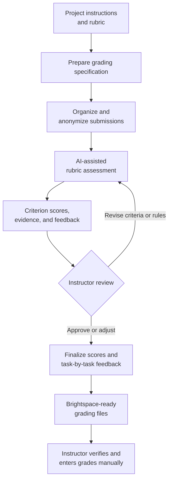

# AI Grader
Human-supervised AI grading assistant for projects, exams, homework, lab reports, programming assignments and spreadsheets

## Set up on a new computer

You need Git and Python 3.10 or newer. In PowerShell, from the folder that should
hold AI Grader:

```powershell
git clone https://github.com/andres-tovar-purdue/ai-grader.git
cd ai-grader
python install.py
```

`install.py` creates `.venv\` and `.env` inside the repository (Git ignores both),
installs AI Grader with `pip install -e .`, creates `projects\` next to the
repository after asking, prompts for `OPENAI_API_KEY` and `OPENAI_MODEL`, and runs
`check-setup` (including one test API request). It is safe to rerun and never
overwrites an existing `.env`; if a check fails, fix it (for example, the key in
`.env`) and run `python install.py` again.

```text
<workspace>\
├── ai-grader\        this repository, with .venv\ and .env
└── projects\         grading projects and student data, outside the repository
```

Run AI Grader from the workspace folder, activating the environment at the start of
each session:

```powershell
.\ai-grader\.venv\Scripts\Activate.ps1
python -m ai_grader check-setup
```

`init-project` refuses to create a project inside a Git repository, so student data
stays out of Git; `projects/` is also in `.gitignore`.

`check-setup` reports the virtual environment, `.env`, API key (never shown), model,
`projects\` folder and API connection. See [USER_MANUAL.md](USER_MANUAL.md) for the
full workflow.

## Human-Supervised Grading Workflow

The grader combines deterministic processing, AI-assisted rubric evaluation, and instructor review. AI-generated assessments remain preliminary until the instructor verifies the evidence and approves the final scores and feedback.



## Project preparation

Install the package in editable mode, place original PDF, Markdown, or plain-text
assignment materials in `PROJECT_PATH/project/`, and place CSV datasets in
`PROJECT_PATH/datasets/`. Then run:

```powershell
python -m ai_grader prepare-project PROJECT_PATH
```

The command preserves original files and creates three drafts:

- `project/project_instructions.md`
- `rubric/instructor_rubric.md`
- `reference/reference_solution.md`

It refuses to overwrite any of these files. Review and edit all three drafts before
running `generate-spec`. The intended workflow is:

```text
prepare-project -> instructor review -> generate-spec -> approve-spec
  -> prepare-submissions -> grade-submissions -> instructor review
```

`prepare-project` reads no student submissions and performs no grading. PDF support
extracts embedded text; scanned image-only PDFs require OCR before use. CSV files up
to 200 KB are supplied in full. Larger CSV files are limited to a labeled sample.

## Submission preparation and grading

Prepare submissions before grading:

```powershell
python -m ai_grader prepare-submissions PROJECT_PATH
```

This writes a sanitized `submission_manifest.json`, a private `student_map.json`,
and physical agent-facing copies beneath
`grader/anonymized_submissions/Student_###/`. A student's Brightspace attempts are
merged: every file from every attempt is kept, and the newest attempt's copy wins
when a file appears more than once. Known usernames and student names are
redacted from text and filenames, including a first name or surname on its own
and handles built from them such as "jchen" or "chenj" (matched as whole words,
so "Chen" is not redacted inside "kitchen"). Image pixels are not redacted and may still
require instructor review if visible identity is suspected.

PDF reports are read locally: their text (not figures or images) is extracted with
pypdf, redacted like other text, capped at 50,000 characters, and given to the
grader. PDFs without extractable text are flagged for manual review. GitHub links
in a student's PDF or notebook are used as repository evidence when index.html has
none for that student, and the student is flagged for review.

ZIP files in submissions and linked repositories are extracted locally (originals
unchanged): each file becomes its own redacted artifact under
`<name>.zip_contents/`, files identical to ones submitted separately are not
repeated, and unsafe, encrypted, damaged or oversized entries are skipped. Archives
that cannot be fully extracted are flagged for review, not penalized.

Rerunning `prepare-submissions` before grading replaces the earlier preparation
(for example, after adding a late submission). Once `grader/grading_runs/` or
`grader/debug_responses/` holds anything, it refuses and changes nothing; set
runs aside first with `python -m ai_grader archive-grading PROJECT_PATH` (moved
to `grader/archive/`, never deleted; finalized runs are never moved).

After the grading specification is instructor-approved, run:

```powershell
python -m ai_grader grade-submissions PROJECT_PATH
```

The model comes from `OPENAI_MODEL` in `.env`, which `install.py` requires.
Override it for one run with `--model MODEL_ID`. If `OPENAI_MODEL` is unset, every
command falls back to `gpt-5.4-mini` (`DEFAULT_MODEL` in `ai_client.py`). Every
command that calls the model first prints the model and whether it came from
`--model`, `OPENAI_MODEL` or the default.
New structured runs record the exact selected model and any token usage returned
by the Responses API. Cost remains unset unless maintainable pricing assumptions
are explicitly configured.

New grading runs default to the versioned `generous-v1` rounding policy. Criterion
scores remain exact. Each raw task subtotal is rounded upward to the next half point
without exceeding the task maximum; rounded task scores are summed and rounded
upward to the next whole point without exceeding the assignment maximum. Exact
half-points and whole numbers remain unchanged using a documented `1e-9`
floating-point tolerance. Use `--rounding-policy exact-v1` to disable rounding for
a run. Existing grading runs are never changed retroactively.

The grader reads only the approved specification, sanitized manifest, and physical
anonymized copies. It sends one independent request per student, structurally
preflights SLX containers without parsing or executing their models, uses required
PNGs for visible Simulink evidence, recalculates totals locally, and creates non-destructive
versioned output beneath `grader/grading_runs/run_v###/`:

- `grading_results.json` contains criterion-level evidence and preliminary scores.
- `preliminary_grading_report.csv` is the instructor-review worksheet.

The CSV leaves `total_instructor_score` blank. No final score or Brightspace update
is performed automatically.

After the instructor approves scores, `finalize-grading` writes the instructor
summary, per-student feedback, and Brightspace feedback files (CSV and one text
file to paste from). `export-brightspace` (or `finalize-grading
--brightspace-template`) fills a grades export downloaded from Brightspace into
`brightspace_grades_import.csv` for Grades > Import. AI Grader never uploads or
releases grades.

## Current Limitations and Roadmap

The Project 2 and Project 3 demonstrations also identified areas for further
development. The following items are planned work, not descriptions of features
that are already complete:

1. Add deterministic notebook preprocessing and token estimation.
2. Detect duplicate, blank, corrupted, and low-information figures before grading.
3. Record complete API-attempt, retry, token-usage, and cost logs.
4. Strengthen structured-output validation and repair.
5. Build an evidence-centered interface for instructor review.
6. Formally support holistic instructor adjustments as records separate from
   rubric-based results.
7. Make workflow runs immutable and versioned while simplifying the current folder
   structure.
8. Brightspace API integration (grades and feedback); today the grades import CSV
   and feedback are uploaded by the instructor.
9. Add regression tests based on deidentified Project 2 and Project 3 cases.
